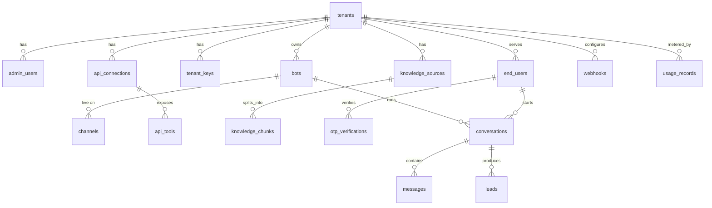

# 03 — Data Model

Status: Draft v0.1 · Depends on: 00, 01, 02, 04 · Database: PostgreSQL 16 + pgvector

## 1. Principles

1. Every tenant-owned table has `tenant_id uuid NOT NULL` and is protected by row-level security (RLS).
2. Primary keys are `uuid` (`gen_random_uuid()`); timestamps are `timestamptz` in UTC.
3. Secrets are stored encrypted at application level (`bytea`), never plaintext, never returned by APIs.
4. Private end-user data from client APIs is **never stored** here; only conversation text, which can contain it, follows the retention rules below.
5. Enumerations use `text` + `CHECK` constraints (easier to evolve than Postgres enums).
6. Deleting a tenant cascades to all its data.

## 2. Entity overview



## 3. Table reference

| # | Table | Purpose | Phase |
|---|---|---|---|
| 1 | `tenants` | A client business | Core |
| 2 | `admin_users` | Dashboard users of a tenant | Core |
| 3 | `bots` | Bot configuration and widget identity | Core |
| 4 | `channels` | Web/WhatsApp attachment of a bot | Core |
| 5 | `tenant_keys` | Keys to verify client-signed user JWTs | Core |
| 6 | `api_connections` | How to reach a client's backend | Core |
| 7 | `api_tools` | Endpoints exposed to the agent | Core |
| 8 | `knowledge_sources` | Origins of public knowledge | Core |
| 9 | `knowledge_chunks` | Embedded text chunks (RAG) | Core |
| 10 | `end_users` | Visitors/customers of the tenant | Core |
| 11 | `otp_verifications` | WhatsApp identity verification | WhatsApp |
| 12 | `conversations` | A chat session | Core |
| 13 | `messages` | Chat turns and agent trace | Core |
| 14 | `leads` | Captured sales leads | Core |
| 15 | `webhooks` | Outbound event subscriptions | Core |
| 16 | `usage_records` | Monthly metering | Core |

## 4. DDL

### 4.1 Extensions and helpers

```sql
CREATE EXTENSION IF NOT EXISTS pgcrypto;
CREATE EXTENSION IF NOT EXISTS vector;
CREATE EXTENSION IF NOT EXISTS citext;

CREATE OR REPLACE FUNCTION set_updated_at() RETURNS trigger AS $$
BEGIN NEW.updated_at = now(); RETURN NEW; END; $$ LANGUAGE plpgsql;
```

### 4.2 Tenancy and access

```sql
CREATE TABLE tenants (
  id              uuid PRIMARY KEY DEFAULT gen_random_uuid(),
  name            text NOT NULL,
  website_domain  text,
  plan            text NOT NULL DEFAULT 'free'
                  CHECK (plan IN ('free','starter','growth')),
  status          text NOT NULL DEFAULT 'active'
                  CHECK (status IN ('active','suspended','deleted')),
  created_at      timestamptz NOT NULL DEFAULT now(),
  updated_at      timestamptz NOT NULL DEFAULT now()
);

CREATE TABLE admin_users (
  id             uuid PRIMARY KEY DEFAULT gen_random_uuid(),
  tenant_id      uuid NOT NULL REFERENCES tenants(id) ON DELETE CASCADE,
  email          citext NOT NULL UNIQUE,
  password_hash  text NOT NULL,                    -- argon2id
  role           text NOT NULL DEFAULT 'admin'
                 CHECK (role IN ('owner','admin','viewer')),
  is_active      boolean NOT NULL DEFAULT true,
  last_login_at  timestamptz,
  created_at     timestamptz NOT NULL DEFAULT now()
);
CREATE INDEX admin_users_tenant_idx ON admin_users(tenant_id);

CREATE TABLE tenant_keys (
  id                     uuid PRIMARY KEY DEFAULT gen_random_uuid(),
  tenant_id              uuid NOT NULL REFERENCES tenants(id) ON DELETE CASCADE,
  kid                    text NOT NULL,            -- key id in JWT header
  algorithm              text NOT NULL CHECK (algorithm IN ('HS256','RS256','ES256')),
  key_material_encrypted bytea NOT NULL,           -- shared secret or public key
  status                 text NOT NULL DEFAULT 'active'
                         CHECK (status IN ('active','rotating','revoked')),
  created_at             timestamptz NOT NULL DEFAULT now(),
  expires_at             timestamptz,
  UNIQUE (tenant_id, kid)
);
```

### 4.3 Bots and channels

```sql
CREATE TABLE bots (
  id               uuid PRIMARY KEY DEFAULT gen_random_uuid(),
  tenant_id        uuid NOT NULL REFERENCES tenants(id) ON DELETE CASCADE,
  name             text NOT NULL,
  system_prompt    text NOT NULL DEFAULT '',
  tone             text NOT NULL DEFAULT 'friendly',
  welcome_message  text NOT NULL DEFAULT 'Hi! How can I help you today?',
  language         text NOT NULL DEFAULT 'en',
  allowed_domains  text[] NOT NULL DEFAULT '{}',
  widget_key       text NOT NULL UNIQUE,           -- public identifier, not a secret
  enabled          boolean NOT NULL DEFAULT true,
  settings         jsonb NOT NULL DEFAULT '{}',    -- e.g. handoff email, lead fields
  created_at       timestamptz NOT NULL DEFAULT now(),
  updated_at       timestamptz NOT NULL DEFAULT now()
);
CREATE INDEX bots_tenant_idx ON bots(tenant_id);
CREATE TRIGGER bots_updated BEFORE UPDATE ON bots
  FOR EACH ROW EXECUTE FUNCTION set_updated_at();

CREATE TABLE channels (
  id                    uuid PRIMARY KEY DEFAULT gen_random_uuid(),
  tenant_id             uuid NOT NULL REFERENCES tenants(id) ON DELETE CASCADE,
  bot_id                uuid NOT NULL REFERENCES bots(id) ON DELETE CASCADE,
  type                  text NOT NULL CHECK (type IN ('web','whatsapp')),
  external_id           text,                      -- WhatsApp phone_number_id
  config                jsonb NOT NULL DEFAULT '{}',
  credentials_encrypted bytea,                     -- WhatsApp access token etc.
  status                text NOT NULL DEFAULT 'active'
                        CHECK (status IN ('active','disabled','error')),
  created_at            timestamptz NOT NULL DEFAULT now(),
  UNIQUE (bot_id, type)
);
CREATE UNIQUE INDEX channels_type_external_uq
  ON channels(type, external_id) WHERE external_id IS NOT NULL;
CREATE INDEX channels_tenant_idx ON channels(tenant_id);
```

### 4.4 Client API integration

```sql
CREATE TABLE api_connections (
  id                    uuid PRIMARY KEY DEFAULT gen_random_uuid(),
  tenant_id             uuid NOT NULL REFERENCES tenants(id) ON DELETE CASCADE,
  name                  text NOT NULL,
  base_url              text NOT NULL,             -- https only, validated (see 04)
  auth_type             text NOT NULL
                        CHECK (auth_type IN ('none','api_key','bearer','oauth2')),
  credentials_encrypted bytea,
  user_token_mode       text NOT NULL DEFAULT 'forward_token'
                        CHECK (user_token_mode IN
                          ('forward_token','service_key_with_user_id','none')),
  timeout_ms            integer NOT NULL DEFAULT 6000 CHECK (timeout_ms BETWEEN 500 AND 15000),
  status                text NOT NULL DEFAULT 'active'
                        CHECK (status IN ('active','disabled','error')),
  created_at            timestamptz NOT NULL DEFAULT now(),
  updated_at            timestamptz NOT NULL DEFAULT now(),
  UNIQUE (tenant_id, name)
);
CREATE INDEX api_connections_tenant_idx ON api_connections(tenant_id);

CREATE TABLE api_tools (
  id                    uuid PRIMARY KEY DEFAULT gen_random_uuid(),
  tenant_id             uuid NOT NULL REFERENCES tenants(id) ON DELETE CASCADE,
  connection_id         uuid NOT NULL REFERENCES api_connections(id) ON DELETE CASCADE,
  name                  text NOT NULL CHECK (name ~ '^[a-z][a-z0-9_]{2,63}$'),
  description           text NOT NULL,             -- shown to the LLM
  method                text NOT NULL CHECK (method IN ('GET','POST','PUT','PATCH','DELETE')),
  path_template         text NOT NULL,             -- e.g. /orders/{order_id}
  request_schema        jsonb NOT NULL DEFAULT '{}',   -- JSON Schema for model-supplied args
  response_fields       text[] NOT NULL DEFAULT '{}',  -- allowlist returned to the LLM
  is_write              boolean NOT NULL DEFAULT false,
  requires_user_auth    boolean NOT NULL DEFAULT true,
  requires_confirmation boolean NOT NULL DEFAULT false,
  enabled               boolean NOT NULL DEFAULT true,
  created_at            timestamptz NOT NULL DEFAULT now(),
  UNIQUE (tenant_id, name),
  CHECK (NOT is_write OR requires_confirmation)    -- writes must confirm
);
CREATE INDEX api_tools_conn_idx ON api_tools(connection_id);
```

### 4.5 Knowledge (RAG)

```sql
CREATE TABLE knowledge_sources (
  id             uuid PRIMARY KEY DEFAULT gen_random_uuid(),
  tenant_id      uuid NOT NULL REFERENCES tenants(id) ON DELETE CASCADE,
  bot_id         uuid REFERENCES bots(id) ON DELETE SET NULL,
  type           text NOT NULL CHECK (type IN ('url','file','text','catalog')),
  title          text,
  source_ref     text NOT NULL,                    -- URL, S3 key, or inline id
  status         text NOT NULL DEFAULT 'pending'
                 CHECK (status IN ('pending','processing','ready','failed')),
  error          text,
  content_hash   text,
  last_synced_at timestamptz,
  created_at     timestamptz NOT NULL DEFAULT now()
);
CREATE INDEX knowledge_sources_tenant_idx ON knowledge_sources(tenant_id, status);

CREATE TABLE knowledge_chunks (
  id           uuid PRIMARY KEY DEFAULT gen_random_uuid(),
  tenant_id    uuid NOT NULL REFERENCES tenants(id) ON DELETE CASCADE,
  source_id    uuid NOT NULL REFERENCES knowledge_sources(id) ON DELETE CASCADE,
  chunk_index  integer NOT NULL,
  content      text NOT NULL,
  embedding    vector(1536) NOT NULL,              -- dimension fixed by embedding model (Q6)
  metadata     jsonb NOT NULL DEFAULT '{}',        -- url, title, section, price, sku...
  created_at   timestamptz NOT NULL DEFAULT now(),
  UNIQUE (source_id, chunk_index)
);
CREATE INDEX knowledge_chunks_tenant_idx ON knowledge_chunks(tenant_id);
CREATE INDEX knowledge_chunks_embedding_idx
  ON knowledge_chunks USING hnsw (embedding vector_cosine_ops);
```

### 4.6 End users, conversations, messages

```sql
CREATE TABLE end_users (
  id               uuid PRIMARY KEY DEFAULT gen_random_uuid(),
  tenant_id        uuid NOT NULL REFERENCES tenants(id) ON DELETE CASCADE,
  external_user_id text,                           -- client's own user id (from JWT sub)
  channel_identity text,                           -- e.g. WhatsApp wa_id
  name             text,
  email            citext,
  phone            text,
  is_verified      boolean NOT NULL DEFAULT false, -- true after JWT or OTP verification
  first_seen_at    timestamptz NOT NULL DEFAULT now(),
  last_seen_at     timestamptz NOT NULL DEFAULT now()
);
CREATE UNIQUE INDEX end_users_ext_uq
  ON end_users(tenant_id, external_user_id) WHERE external_user_id IS NOT NULL;
CREATE UNIQUE INDEX end_users_channel_uq
  ON end_users(tenant_id, channel_identity) WHERE channel_identity IS NOT NULL;

CREATE TABLE otp_verifications (
  id            uuid PRIMARY KEY DEFAULT gen_random_uuid(),
  tenant_id     uuid NOT NULL REFERENCES tenants(id) ON DELETE CASCADE,
  end_user_id   uuid NOT NULL REFERENCES end_users(id) ON DELETE CASCADE,
  code_hash     text NOT NULL,                     -- hash, never the code
  expires_at    timestamptz NOT NULL,
  attempts      integer NOT NULL DEFAULT 0,
  max_attempts  integer NOT NULL DEFAULT 5,
  verified_at   timestamptz,
  created_at    timestamptz NOT NULL DEFAULT now()
);
CREATE INDEX otp_user_idx ON otp_verifications(end_user_id, created_at DESC);

CREATE TABLE conversations (
  id              uuid PRIMARY KEY DEFAULT gen_random_uuid(),
  tenant_id       uuid NOT NULL REFERENCES tenants(id) ON DELETE CASCADE,
  bot_id          uuid NOT NULL REFERENCES bots(id) ON DELETE CASCADE,
  channel_id      uuid NOT NULL REFERENCES channels(id) ON DELETE CASCADE,
  end_user_id     uuid NOT NULL REFERENCES end_users(id) ON DELETE CASCADE,
  status          text NOT NULL DEFAULT 'bot'
                  CHECK (status IN ('bot','handoff','closed')),
  assigned_to     uuid REFERENCES admin_users(id) ON DELETE SET NULL,
  handoff_reason  text,
  metadata        jsonb NOT NULL DEFAULT '{}',
  started_at      timestamptz NOT NULL DEFAULT now(),
  last_message_at timestamptz NOT NULL DEFAULT now(),
  ended_at        timestamptz
);
CREATE INDEX conversations_tenant_idx ON conversations(tenant_id, last_message_at DESC);
CREATE INDEX conversations_user_idx ON conversations(end_user_id, last_message_at DESC);
CREATE INDEX conversations_status_idx ON conversations(tenant_id, status);

CREATE TABLE messages (
  id               uuid PRIMARY KEY DEFAULT gen_random_uuid(),
  tenant_id        uuid NOT NULL REFERENCES tenants(id) ON DELETE CASCADE,
  conversation_id  uuid NOT NULL REFERENCES conversations(id) ON DELETE CASCADE,
  role             text NOT NULL CHECK (role IN ('user','assistant','tool','system')),
  content          text NOT NULL,
  tool_calls       jsonb,                          -- name, args (redacted), status, duration
  model            text,
  tokens_in        integer,
  tokens_out       integer,
  latency_ms       integer,
  created_at       timestamptz NOT NULL DEFAULT now()
);
CREATE INDEX messages_conv_idx ON messages(conversation_id, created_at);
CREATE INDEX messages_tenant_created_idx ON messages(tenant_id, created_at);
```

### 4.7 Sales, integration events, billing

```sql
CREATE TABLE leads (
  id              uuid PRIMARY KEY DEFAULT gen_random_uuid(),
  tenant_id       uuid NOT NULL REFERENCES tenants(id) ON DELETE CASCADE,
  conversation_id uuid REFERENCES conversations(id) ON DELETE SET NULL,
  end_user_id     uuid REFERENCES end_users(id) ON DELETE SET NULL,
  name            text,
  email           citext,
  phone           text,
  interest        text,
  status          text NOT NULL DEFAULT 'new'
                  CHECK (status IN ('new','contacted','qualified','won','lost')),
  notes           text,
  created_at      timestamptz NOT NULL DEFAULT now(),
  updated_at      timestamptz NOT NULL DEFAULT now(),
  CHECK (email IS NOT NULL OR phone IS NOT NULL)   -- need a way to reach the lead
);
CREATE INDEX leads_tenant_idx ON leads(tenant_id, status, created_at DESC);

CREATE TABLE webhooks (
  id               uuid PRIMARY KEY DEFAULT gen_random_uuid(),
  tenant_id        uuid NOT NULL REFERENCES tenants(id) ON DELETE CASCADE,
  url              text NOT NULL,
  secret_encrypted bytea NOT NULL,                 -- HMAC signing secret
  events           text[] NOT NULL,                -- lead.created, handoff.requested
  enabled          boolean NOT NULL DEFAULT true,
  created_at       timestamptz NOT NULL DEFAULT now()
);
CREATE INDEX webhooks_tenant_idx ON webhooks(tenant_id);

CREATE TABLE usage_records (
  id             uuid PRIMARY KEY DEFAULT gen_random_uuid(),
  tenant_id      uuid NOT NULL REFERENCES tenants(id) ON DELETE CASCADE,
  period         date NOT NULL,                    -- first day of month, UTC
  message_count  integer NOT NULL DEFAULT 0,
  tokens_in      bigint NOT NULL DEFAULT 0,
  tokens_out     bigint NOT NULL DEFAULT 0,
  whatsapp_msgs  integer NOT NULL DEFAULT 0,
  updated_at     timestamptz NOT NULL DEFAULT now(),
  UNIQUE (tenant_id, period)
);
```

## 5. Row-level security

Roles:
- `app_user`: used by request handlers. Subject to RLS.
- `app_system`: used only by `db/system_queries.py` for pre-tenant lookups (widget key, WhatsApp phone number ID, login by email) and by workers that iterate tenants. Grants are limited to the specific tables and columns needed.

```sql
-- applied to every table that has tenant_id (example for one table)
ALTER TABLE bots ENABLE ROW LEVEL SECURITY;
ALTER TABLE bots FORCE ROW LEVEL SECURITY;
CREATE POLICY tenant_isolation ON bots
  USING (tenant_id = current_setting('app.tenant_id', true)::uuid)
  WITH CHECK (tenant_id = current_setting('app.tenant_id', true)::uuid);
```

For `tenants` itself, the policy uses `id = current_setting('app.tenant_id', true)::uuid`.

Request flow: dependency resolves tenant → `SET LOCAL app.tenant_id = '<uuid>'` inside the transaction → queries run. If `app.tenant_id` is unset, policies match nothing (fail closed).

## 6. Index and query-pattern summary

| Pattern | Table / index |
|---|---|
| Resolve bot by `widget_key` (pre-tenant) | `bots.widget_key` unique, via `app_system` |
| Resolve WhatsApp inbound by phone number ID | `channels(type, external_id)` unique, via `app_system` |
| Admin login by email | `admin_users.email` unique, via `app_system` |
| Load conversation history | `messages(conversation_id, created_at)` |
| Dashboard conversation list | `conversations(tenant_id, last_message_at DESC)` |
| Lead inbox by status | `leads(tenant_id, status, created_at DESC)` |
| RAG retrieval | `knowledge_chunks` HNSW cosine, filtered `WHERE tenant_id = $1` (and by bot/source if set) |
| Find end user by client id / WhatsApp id | `end_users` partial unique indexes |
| Monthly usage upsert | `usage_records(tenant_id, period)` unique |

Vector search note: always filter by `tenant_id`. If recall suffers with filtering on HNSW, raise `hnsw.ef_search` or move large tenants to partitions; revisit in f05.

## 7. Encryption and secrets

- Columns ending `_encrypted` hold AES-256-GCM ciphertext (`nonce || ciphertext || tag`), produced by an app-level helper using a data key from KMS/secrets manager.
- Key rotation: re-encrypt rows lazily on read/write; store key version in the first byte.
- Never select `_encrypted` columns in list endpoints; decrypt only in the connector/channel code that needs them.

## 8. Retention and deletion

| Data | Default retention | Notes |
|---|---|---|
| `messages` | 90 days (configurable per tenant, Q5) | Nightly purge job |
| `conversations` | Kept while messages exist, then metadata trimmed | |
| `otp_verifications` | 24 hours | Purge job |
| `leads` | Until tenant deletes | Owned by the tenant |
| `end_users` | Until deletion request or tenant deletion | Deletion = anonymise (null name, email, phone, identities), keep counts |
| `knowledge_*` | Until source deleted | Cascade |
| Tenant deletion | Soft delete (`status='deleted'`), hard purge after 30 days | Cascade removes all rows |

Deletion request flow (DPDP/GDPR): by `external_user_id` or phone → anonymise `end_users`, delete messages for their conversations, null lead PII if requested by the tenant.

## 9. Migration plan (Alembic)

| Rev | Content |
|---|---|
| 0001 | Extensions, helper functions, roles |
| 0002 | `tenants`, `admin_users`, `tenant_keys` + RLS |
| 0003 | `bots`, `channels` + RLS |
| 0004 | `end_users`, `conversations`, `messages` + RLS |
| 0005 | `knowledge_sources`, `knowledge_chunks` + HNSW index |
| 0006 | `api_connections`, `api_tools` |
| 0007 | `leads`, `webhooks` |
| 0008 | `usage_records` |
| 0009 | `otp_verifications` (with WhatsApp feature) |

Rule: a migration and its matching spec change ship together.

## 10. Seed and test data

- Dev seed: two tenants (`acme`, `globex`) each with one admin, one bot, one web channel, a few knowledge chunks. Used by cross-tenant isolation tests.
- Fixtures must never contain real PII.

## 11. Acceptance criteria for the data layer

| ID | Criterion |
|---|---|
| DM-1 | All migrations apply on an empty DB and roll back cleanly. |
| DM-2 | With `app.tenant_id` = A, selecting from every tenant table returns zero rows of tenant B. |
| DM-3 | With `app.tenant_id` unset, every tenant table returns zero rows. |
| DM-4 | Inserting a row with another tenant's `tenant_id` is rejected by RLS. |
| DM-5 | A write tool without `requires_confirmation` is rejected by the CHECK constraint. |
| DM-6 | Deleting a tenant removes all dependent rows. |
| DM-7 | Vector search with a tenant filter never returns another tenant's chunks. |
| DM-8 | `_encrypted` columns never contain plaintext in dev seed or tests. |

## 12. Open questions

| # | Question |
|---|---|
| Q5 | Retention default for messages (90 days proposed)? |
| Q6 | Embedding model, which fixes `vector(N)`. |
| Q9 | Does the tenant need multiple bots in v1, or one bot per tenant? (Schema supports many.) |
| Q10 | Store `webhook_deliveries` for debugging in v1, or rely on logs? (Not in schema yet.) |
